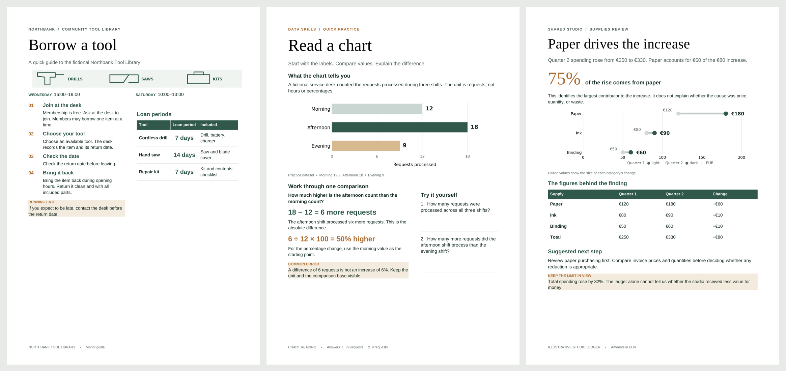

# Original design specimens

Three small, fictional A4 documents explore how the composition should change with the job. These are review candidates, not accepted before/after evidence and not proof of a better skill. The current installed skill has not been revised as part of this checkpoint.

[All three pages](specimens.pdf) · [Source research](../../docs/design-source-map.md)

| Specimen | Files | Design decision |
| --- | --- | --- |
| Community guide | [DOCX](community-guide.docx) / [PDF](community-guide.pdf) | Separate the four-step process from a compact loan table. Opening hours sit above both. Original tool drawings establish the subject without using private material. |
| Study sheet | [DOCX](study-sheet.docx) / [PDF](study-sheet.pdf) | Put the chart first, distinguish absolute and percentage change, then separate worked material from space to practise. |
| Analytical brief | [DOCX](analytical-brief.docx) / [PDF](analytical-brief.pdf) | Lead with a finding, show its calculation and chart, then give the editable ledger and the limits of the interpretation. |



## Composition recipes

All pages use A4, 18 mm side margins, 17 mm top/bottom margins, Liberation Serif titles and Liberation Sans body text. A restrained green/sand/amber family connects elements within each example. It is a sample direction, not a required color scheme for future documents.

- **Guide:** an original line-art ribbon, native Word columns of 80/84 mm with a 10 mm gap, numbered steps, and a real three-column data table. Loan periods receive emphasis because they affect the reader's next action. This arrangement suits a short visitor guide; longer regulations need a different structure.
- **Study:** a zero-baseline horizontal bar chart, visible units and values, a 100/64 mm native column split, and two ruled answer areas. Worked formulas remain text. This is for learning and practice, not a dense reference card.
- **Analysis:** a prominent 75% contribution figure, paired values rather than decorative charting, an editable source table, and a distinct limitation note. The finding is a contribution to change, not evidence of a cause.

The [source map](../../docs/design-source-map.md) records inspected references and their limits. No upstream layout, code, image, logo, or template is copied into these files. All illustrations and chart assets are generated by build.py; fixtures are fictional. The tool-library operating facts come from the repository's purpose-written public exercise and are preserved.

## Code imagery: ray.so

Preferred route: [ray.so](https://ray.so/). Use [availability.sql](availability.sql), title `availability.sql`, Forest theme, light code, background off, padding 32, and SQL syntax. The actual browser preview was tested. PNG/SVG export did not complete in that browser session; no exported ray.so asset is included or claimed.

[Recreate the safe fictional example](https://ray.so/#code=U0VMRUNUIHRpdGxlLCBhdmFpbGFibGVfY29waWVzCkZST00gYm9vawpXSEVSRSBhdmFpbGFibGVfY29waWVzID4gMApPUkRFUiBCWSB0aXRsZTs&title=availability.sql&theme=forest&background=false&darkMode=false&padding=32). A URL can contain the code itself; never substitute confidential source without permission. Keep the SQL beside any future exported artwork, and inspect text at its actual document size. A local fallback must be identified explicitly.

## Rebuild and review

Free dependencies: Python, python-docx, Matplotlib, Pillow, and a free DOCX-capable office renderer. Run:

```sh
python build.py
```

Render the three resulting DOCX files with your available office renderer, export matching PDFs, and inspect every page. The checked-in PDFs/previews are reviewed exports, not generated by build.py alone. SVG and PNG assets are retained alongside fixtures.json. SVG text appearance depends on installed fonts; charts in the DOCX use PNG for compatibility.

Verification at this checkpoint: each final PDF is one A4 page; all three final pages were visually inspected; body text, formulas and data tables remain native DOCX content; charts have descriptions, and numeric chart values also appear as text or table data. Guide hours, loan periods, included parts and borrowing facts were checked against the public fixture. Arithmetic: 12+18+9=39, 18−12=6, 6/12=50%, 18−9=9; budget totals 250→330, +80, +32%, paper +60/80=75%.

Limits: these are authored specimens, not an independent evaluation. PDF/DOCX appearance may vary across office viewers. Embedded chart images are not native Word charts. These files have not undergone an accessibility-conformance audit. The package security scan applies to the unchanged skill package, not these added example files.
